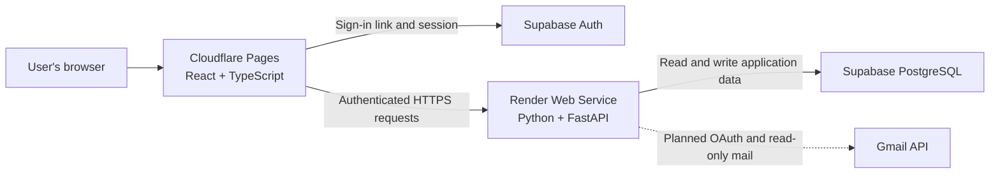

# Alongside — project record and resume checkpoint

**Updated: 4 November 2026 (Asia/Kolkata).**

This is the maintained record of product decisions, implementation, deployment, verification and remaining work. It distinguishes repository implementation, confirmed cloud deployment, user-reported configuration and unverified live behavior. No passwords, OAuth client secrets, API tokens, session tokens or private connection strings belong in this document.

## 1. What we are building

The product began as Job Radar, based on the uploaded job-search PRD. It is now named **Alongside — Guidance for your next step**. The longer-term idea is support for students, potentially including mentorship. That broader offering is still exploratory: learning, mentoring and other student services have not been implemented.

The current beta is a job-search workspace: collect opportunities, review matches, maintain a confirmed resume and track applications. The first release is invite-only and targets an initial ₹0 infrastructure budget.

### Decisions that supersede the original PRD

| Area | Current decision |
|---|---|
| Product name | Alongside; earlier resource names such as Job Radar and Job-automation remain in use. |
| Access | Invite-only beta, with an owner-admin screen inside the app. |
| Owner | arkapravo.mukherjee10@gmail.com; admin privileges require verified sign-in. |
| Applications | Users apply on employer/job-portal sites themselves. Auto-application was explicitly removed. |
| Preferences | Multiple target roles and locations; any listed role and any listed location can satisfy the respective filter. |
| Resume entry | Upload, prefill editable fields, review, then confirm a new base version. |
| Validation | Python consistency checks; no claim of mathematical proof that all rewritten statements are truthful. |
| Login | Supabase's default emailed verification/sign-in link, rather than a typed email code. |
| Inbox goal | Read-only Gmail connection to find relevant job emails and track application confirmations and updates. This is not implemented yet. |
| AI | Future user-funded integrations; no current live tailoring or resume-chat integration. |
| Working style | Guide the owner one step at a time and wait for explicit completion before the next user action. |

## 2. How the services fit together

- **GitHub** holds the source code, tests and this documentation.
- **Cloudflare Pages** serves the website: the pages, forms and browser JavaScript users see. It does not hold the database password or Google client secret.
- **Render** runs the Python backend as a web service. FastAPI handles API requests; Uvicorn is the server process that runs it.
- **Supabase PostgreSQL** persists jobs, preferences, confirmed resume versions, activity, invitations and verified app-signup metadata.
- **Supabase Auth** proves the identity of a person signing in. Our backend separately determines whether that person is allowed to use the beta.
- **Google Cloud / Google Auth Platform** is being configured for future Gmail access. It is not hosting our application or replacing Supabase login.

### Two email features that must not be confused

| Feature | Purpose | Provider and current status |
|---|---|---|
| Email-link login | Verify the user's identity and establish an app session. | Supabase Auth. Frontend flow implemented; email delivery observed; complete live sign-in/admin access still needs verification. |
| Connect Gmail inbox | Read relevant emails in a mailbox the user explicitly authorizes. | Gmail API through Google OAuth. Cloud configuration partly completed; application integration not built. |

The Google consent screen and client we created are for inbox access, not for the existing Supabase sign-in link.

## 3. Resource inventory

These identifiers and public URLs are safe to retain. They are not secret credentials.

| Resource | Identifier / URL |
|---|---|
| GitHub repository | https://github.com/arkapravomukherjee10/Job-automation |
| Deployment branch | main |
| Cloud checkout | /workspace/Job-automation |
| Frontend project | Cloudflare Pages project job-radar |
| Public frontend | https://job-radar-940.pages.dev |
| Backend service | Render service job-radar-api |
| Public backend | https://job-radar-api-sudh.onrender.com |
| Health endpoint | https://job-radar-api-sudh.onrender.com/health |
| Supabase project | Job-automation |
| Supabase reference | ekabmffctvduwzhxqrmx |
| Supabase project URL | https://ekabmffctvduwzhxqrmx.supabase.co |
| Google Cloud project name | Job Radar |
| Google Cloud project ID | job-radar-513704 |
| Google consent-screen app name | Alongside |
| Google OAuth client name/type | Alongside Web / Web application |
| Registered future Gmail callback | https://job-radar-api-sudh.onrender.com/api/gmail/callback |

**The registered Gmail callback does not exist in the backend yet.** Registering it with Google reserved the intended address; it did not implement the route or connect an inbox.

We changed the visible brand without changing existing service URLs, repository names or project IDs. Existing integration addresses therefore remain valid.

## 4. Application functionality in the repository

### Dashboard and job tracking

- Home, To do, Jobs, Settings, and an owner-only Admin screen.
- Responsive layouts, activity history and empty/error/loading states.
- Add a job manually by pasting its URL and description. Adding a URL does not fetch or scrape its page.
- A basic deterministic score based on preferred-skill mentions, plus role/location substring filters.
- Multiple role/location preferences, company exclusions, near misses and duplicate-URL prevention.
- Search, stage filtering, manual stage changes and original-posting links.
- Mark as applied records an applied timestamp, displays Already applied and disables repeat application confirmation. The marker survives later stage changes.

**Current application flow:** add/find a job → open its original posting → apply there → return and mark it applied. Future Gmail confirmation tracking should automate the final status update, but opening the original link alone must never count as an application.

The full PRD's weighted criteria engine, taxonomy, salary estimation and culture inference are not implemented. The current score must not be presented as that complete model.

### Resume processing

- Accept text-based PDF and DOCX files up to 5 MB, after processing consent.
- Extract text and prefill a structured editable review form using local rules.
- Detect common section headings, skills, experience bullets and exact experience-detail lines. Keep ambiguous information for review instead of inventing fields.
- Save a confirmed base resume as a new version; previous saved versions remain.
- Check edited structured resumes for unchanged facts, allowed skills, source bullet IDs, source-specific numbers, text similarity and length.
- Display violations and a reminder to review the meaning of rewritten claims.

Prefill is not infallible, OCR is absent, and similarity checks cannot prove factual truthfulness. Upload originals are processed transiently rather than saved in cloud file storage. AI tailoring, resume chat, PDF rendering and side-by-side diff are still future work.

### Owner admin and invitations

- The owner email is fixed server-side to arkapravo.mukherjee10@gmail.com.
- A verified owner session gets Admin access; a browser-provided role or email field cannot grant it.
- Admin can add, remove and restore access by email inside the app.
- Users create/verify their own identity through the email-link login flow; no routine manual Supabase user provisioning is intended.
- Verified but uninvited users see a waiting screen and cannot use private APIs.
- Revoking an invitation blocks subsequent private requests even with an existing session, while retaining that user's saved data.
- The signup list records first verified app sign-in and last-seen time. It does not list unverified email attempts or every historical Supabase-only account.
- Adding an invited email does not send a product invitation email. The admin shares the app URL.
- Existing legacy INVITED_EMAILS entries are imported without restoring already-revoked access on restart.

The tables beta_invitations and beta_members are separate from per-user records. RLS and restricted frontend-role privileges are applied to the backend-managed tables.

### Sign-in, sign-out and usability

- Email-link request with account creation allowed; Supabase consumes a valid returned session automatically.
- Waiting/access-error screens and private-data checks after authentication.
- Visible Sign out in the persistent header, including mobile, and on access-error/waiting screens.
- Clear local session/private UI state on sign-out; reload stays signed out in browser regression tests.
- Higher text contrast, larger controls, focus indicators, navigation semantics and a skip link.
- Keyboard-accessible modal dialogs, focus containment/restoration, Escape dismissal and safe destructive-action confirmations.
- Email resend countdown and guidance for expired links.

See [UX_REVIEW.md](UX_REVIEW.md) for the review scope and limits.

## 5. Deployment work completed

### Render backend

- Connected the GitHub repository and main branch.
- Selected Python and the Free web-service instance.
- Root directory: backend.
- Build command: `pip install -r requirements.txt`.
- Start command: `uvicorn app.main:app --host 0.0.0.0 --port $PORT`.
- Configured PostgreSQL through the Supabase Session pooler with TLS.
- Configured the frontend origin as https://job-radar-940.pages.dev.
- Successful service deployment and database health response were reported by the owner.

An initial repeated database authentication failure led to a supported connection change: DATABASE_URL can now contain no password, while DB_PASSWORD supplies the exact raw password separately. This avoids manual URL encoding. A successful deployment followed the password/configuration corrections.

### Cloudflare frontend

- GitHub app repository access was granted, but the dashboard connection loop was not resolved.
- Deployment was completed through Cloudflare API/CLI uploads using a limited Pages-edit token.
- Production builds embed only public frontend settings, including the Supabase publishable client key. They do not embed backend credentials.
- Later frontend updates, including admin features, login wording, usability fixes and Alongside branding, were uploaded successfully.
- Login HTML has no-store caching headers, and a release label was added to distinguish older browser pages.

**Important:** pushing a commit does not automatically publish the frontend. The current Cloudflare workflow requires building and uploading the frontend. Render is connected to GitHub, but its live deployed commit should still be checked when troubleshooting backend changes.

## 6. Login decisions and unresolved observations

We first explored typed one-time codes. Supabase's hosted template screen then showed that custom SMTP was required to edit the default email templates. To avoid a domain/email-service setup for the initial owner test, the owner chose the default verification-link flow instead.

No domain was purchased, and custom SMTP was not configured. The typed-code flow is not the current product decision.

Observed evidence:

- The owner could open the deployed sign-in screen.
- Emails arrived after requesting verification/sign-in.
- There were signup-disallowed errors while an older frontend was loaded. Updated builds enabled account creation and added release labels.
- A later verification-link attempt produced Load failed.
- The backend health endpoint worked in the owner's browser.
- The owner updated/redeployed the frontend-origin setting in Render.
- Sign out and clearer connection-error states were subsequently implemented and deployed.

**Not yet confirmed:** a successful real owner sign-in all the way to the live Admin screen after these corrections. Browser tests with simulated sessions are evidence of application behavior, not proof that hosted email verification, JWT validation and CORS work together in production.

Supabase's default sender has recipient restrictions and low limits. Delivering an owner email does not prove delivery to every invited external user. A production multi-user beta may still need custom SMTP.

## 7. Gmail setup completed so far

The following Google-side configuration was completed in the guided session:

1. Created the Google Cloud project Job Radar.
2. Enabled Gmail API.
3. Created initial Google Auth Platform / consent-screen branding using Alongside.
4. Selected External audience and development/testing use.
5. Set support/developer contact details.
6. Added the owner's Google account as a test user.
7. Added exactly `https://www.googleapis.com/auth/gmail.readonly` to Data Access.
8. Created the Alongside Web OAuth client as a Web application.
9. Registered the future callback URL listed in the inventory; JavaScript origins were left blank for the planned backend flow.
10. Retrieved the client ID and secret and saved Google credential variables in Render. The owner reported the ensuing deployment successful.

**No Gmail inbox has been connected or read by the app.** Current code still reports Gmail as unavailable and contains no Gmail OAuth callback, token exchange, refresh-token storage, mailbox sync or email-based application updates.

The registered credentials are prerequisites, not a completed integration. They are configured in Render; they were not shared in this document.

### Exact pause point

We had just asked the owner to add **GMAIL_ENCRYPTION_SECRET** in Render: a separate, randomly generated value of at least 32 characters, not reused from another password or secret, and stored unchanged without URL encoding.

**The owner has not confirmed that this encryption secret was created or saved.** Its presence in Render has not been independently verified. Do not assume it exists and do not ask for its value in chat.

The backend implementation for using this setting is also still pending.

## 8. Configuration and credential inventory

Names only; actual secret values must remain in provider settings or the secure environment store.

| Setting | Location | Purpose / status |
|---|---|---|
| APP_MODE | Render | production |
| PYTHON_VERSION | Render | 3.12.14 configured during deployment |
| DATABASE_URL | Render | Password-free PostgreSQL pooler URL, using the psycopg driver and TLS |
| DB_PASSWORD | Render | Secret: exact database password; never URL-encode when supplied separately |
| SUPABASE_URL | Render | Identity-provider/project URL |
| FRONTEND_ORIGINS | Render | Browser origin allowed to call the API; current canonical Pages origin |
| INVITED_EMAILS | Render, legacy | No longer needed for ongoing invitations; app imports existing entries |
| GOOGLE_CLIENT_ID | Render | OAuth client identifier; owner reports saved |
| GOOGLE_CLIENT_SECRET | Render | Secret: Google OAuth client credential; owner reports saved |
| GOOGLE_REDIRECT_URI | Render | Planned callback URL; owner reports saved |
| GMAIL_ENCRYPTION_SECRET | Render, pending confirmation | Secret intended to protect stored Gmail tokens; saving and usage not confirmed |
| VITE_API_URL | Frontend build / Cloudflare | Public Render API address |
| VITE_SUPABASE_URL | Frontend build / Cloudflare | Public Supabase address |
| VITE_SUPABASE_ANON_KEY | Frontend build / Cloudflare | Public browser client key; the setting name is retained although its value is a publishable key |
| VITE_LOCAL_DEMO | Production frontend build | false |
| SUPABASE_ACCESS_TOKEN | Secure Codex environment; destination api.supabase.com | Management credential with limited permissions; not a production app credential |
| CLOUDFLARE_API_TOKEN | Secure Codex environment; destination api.cloudflare.com | Limited Pages deployment credential |

The Google client secret belongs in Render, not in browser build variables. The future Gmail encryption secret and database password also belong only on the backend. No per-user Gmail tokens have been collected or stored yet.

### Different expiration concepts

- A Supabase personal access token expires according to its selected lifetime; it may need replacement for future CLI/API administration. That does not stop application database access or Supabase user login.
- A Google OAuth client secret is not the same as a user's Gmail access/refresh tokens.
- Google testing-mode refresh tokens for Gmail access typically expire after seven days; reconnection may be needed during development. Check current Google requirements before broader release.
- Cloudflare token validity depends on its configured lifetime/permissions.

Do not renew or rotate credentials merely because another service fails. Identify the failing operation and check the relevant credential first.

## 9. Verification record

| Check | Evidence / boundary |
|---|---|
| Backend tests | Latest full regression run: 22 passed before branding; branding changed the API title only. |
| UI regression suite | Nine browser scenarios passed with simulated authentication/API responses. |
| Screen sizes | Automated checks at 360, 768 and 1440px. |
| Accessibility | No violations reported in the scanned states using axe WCAG 2 A/AA, 2.1 A/AA, 2.2 AA and best-practice tags. Not a full conformance certification. |
| Branding regression | Four relevant browser/accessibility checks and the build passed after the Alongside rename. |
| Frontend build | Successful production builds; latest branding upload confirmed by Cloudflare CLI. |
| Dependency audit | Last frontend audit reported zero known vulnerabilities. |
| Public API health | Owner reported status ok / mode production, which includes a database query. |
| Anonymous private API | Owner confirmed sign-in was required. |
| Real full owner login/admin | Still needs confirmation. |
| Gmail connection and sync | Not implemented or run. |

Workspace egress restrictions blocked some requests to the deployed public sites. A proxy 403 from the workspace is not proof that the public application itself failed. Those restrictions also mean local test passes cannot be relabeled as live end-to-end verification.

## 10. Cost position and constraints

The target remains ₹0 initial infrastructure, using free tiers where available. We have not audited billing dashboards or guaranteed that every future operation stays free.

- Cloudflare Pages serves the static frontend using the current upload workflow.
- Render Free can sleep after inactivity; first requests can be slow. It is not a dependable continuously running Gmail worker.
- Supabase Free has database/authentication quotas and default email-delivery limits.
- Creating the Google project, enabling Gmail API and creating OAuth configuration did not require us to purchase hosting or enable billing in the guided steps.
- A domain is optional for the current website and default-link login. Reliable external email delivery may require a separate sending setup.
- Gmail read-only access uses a restricted scope. Testing mode is not proof of public-launch readiness; verification/security assessment requirements and possible costs must be investigated before broader release.
- AI integrations, paid job feeds and scheduled worker hosting have not been activated.

## 11. What remains to build or validate

### Immediate Gmail work

- Confirm secure encryption-secret configuration in Render.
- Implement per-user OAuth initiation with explicit consent and secure, expiring, single-use state; bind the connection to the signed-in user.
- Implement the registered callback and code exchange, identity/mailbox confirmation and encrypted token storage.
- Refresh expired access tokens safely and support disconnect/revocation without exposing credentials.
- Add working Connect Gmail, connection status and manual-sync controls.
- Read only appropriately filtered job/application emails. Keep raw bodies transient and store only required metadata.
- Match confirmation/status emails conservatively, keep ambiguous matches for user review, and avoid duplicate or backward status changes.
- Test two-user isolation, expired/denied consent, replay protection, disconnect and token errors before claiming readiness.
- Test a real Google test-user connection. The present free hosting plan still needs a deliberate scheduling solution for automatic checks; do not promise continuous inbox monitoring.

### Other unfinished product work

- Full PRD scoring/taxonomy/salary/culture features.
- Live permitted job-feed ingestion.
- AI provider connection, truthful tailoring/review, chat and PDF output.
- Per-job timelines and application-to-resume-version association.
- Full account deletion, retention automation and data export.
- Remaining beta hardening such as request limits and document-parser isolation.
- Live multi-user authentication and email-delivery verification.

Automatic job submission remains out of scope; Gmail tracking must not reintroduce it.

## 12. How to resume

Say **“Resume Alongside Gmail setup.”**

Start by asking whether GMAIL_ENCRYPTION_SECRET was saved, inspecting available configuration metadata without printing secrets, and confirming Render is Live. Do not repeat Google project/client creation, reset the database password, or ask for credential values in chat.

Then implement and validate the connection code before asking the owner to connect an inbox. Clearly separate implemented code, deployed code and real Gmail verification. Continue giving only one user action at a time, waiting for explicit completion.

Before widening the beta, return to the unresolved live login/admin check. If Load failed recurs, capture the actual screen/error and test browser-to-backend access; do not assume either email verification or CORS succeeded solely from /health.

## 13. Useful source and documentation links

- [README](../README.md): local run commands and basic project overview.
- [Deployment guide](DEPLOYMENT.md): service configuration and operational details.
- [Current scope](SCOPE.md): implementation limits and the removal of auto-apply.
- [UX review](UX_REVIEW.md): accessibility/usability changes and tests.
- [Python API](../backend/app/main.py), [invitation logic](../backend/app/access.py), [resume parsing](../backend/app/parsing.py), [validator](../backend/app/validation.py).
- [Frontend](../frontend/src/App.tsx), [admin panel](../frontend/src/AdminPanel.tsx), [browser tests](../frontend/tests/ux.spec.ts).

Update this record when decisions, deployment status or verification evidence change. Mark uncertain items as uncertain rather than inferring completion from configuration screenshots or a successful unrelated deployment.
