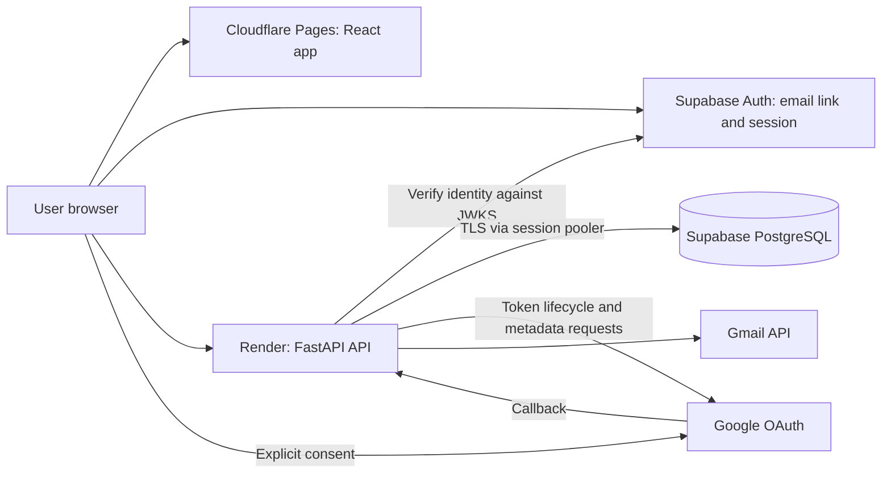

# Alongside architecture

**Baseline:** 16 November 2026. Source is merged on main. The new Gmail backend started successfully on Render and its status route required sign-in. The Cloudflare upload and real mailbox test remain pending.

## Boundaries and main flows

| Boundary | Current implementation |
| --- | --- |
| Browser | Keeps the Supabase session and transient UI state. Calls Render with bearer authentication. Hosts no backend secrets. |
| API | Validates identity and invitation per private request. Resolves workspace owner from the verified identity. Handles business rules, token exchange, and persistence. |
| Database | Stores workspace items, invitations, verified signups and Gmail state. Frontend roles lack access to backend-managed tables. |
| Providers | Supabase authenticates accounts. Google separately authorizes Gmail. Cloudflare serves static assets and does not call Gmail. |

1. **Workspace load:** Supabase returns a verified session. Browser checks `/api/access`, then fetches `/api/state` if invited. Backend verifies JWT and resolves ownership.
2. **Job update:** Browser sends a validated payload. Backend applies score/status rules and writes the owner-scoped job, plus an activity entry. Resume upload is parsed transiently, and only a user-confirmed structured resume is versioned.
3. **Gmail authorization:** Authenticated POST creates expiring state, browser verifier hash and PKCE data. Google redirects to the public backend callback. Server exchanges the code, verifies returned Gmail scope and mailbox profile, and stores an encrypted pending result. Fixed frontend redirect returns the state fragment. Authenticated completion requires the original owner and browser verifier before activation.
4. **Gmail sync:** Authenticated manual POST obtains a database lease, refreshes tokens if necessary, and requests a filtered page of Gmail headers. It writes deduplicated metadata and review suggestions, with a connection generation guard against stale writes. No job records are mutated.
5. **Disconnect:** Backend attempts Google revocation and removes local pending data, encrypted tokens and imported metadata. Revocation failure is surfaced in the disconnect response.

## Operational behavior

- Database connection or schema-initialization failure can prevent startup. Check deployed logs and verify the Supabase project/pooler before retrying Render. `/health` checks database connectivity, while the protected Gmail endpoint distinguishes the new backend from the old release.
- Releases are independent. Render tracks main, while Cloudflare requires a build and upload. Verify backend first, publish the matching frontend, then test the complete browser round trip.
- Gmail authorization expires after 10 minutes. Sync uses bounded batches, provider timeouts, a lease and deduplication. No queue or scheduled worker exists.
- Restore compatible releases through each provider’s deployment controls if a release fails. Table definitions are created at startup and rollback of app code is separate from database cleanup. Confirm access and health before promoting a replacement.
- Limitations include cold starts, provider-specific email delivery, and no general background job or formal migration framework. See [data model](datamodel.md), [security](Security.md), and [build plan](buildplan.md).
